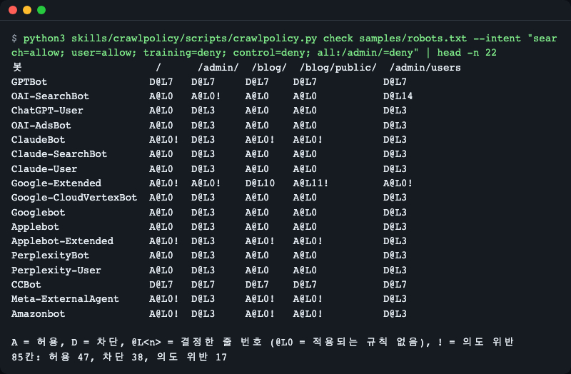
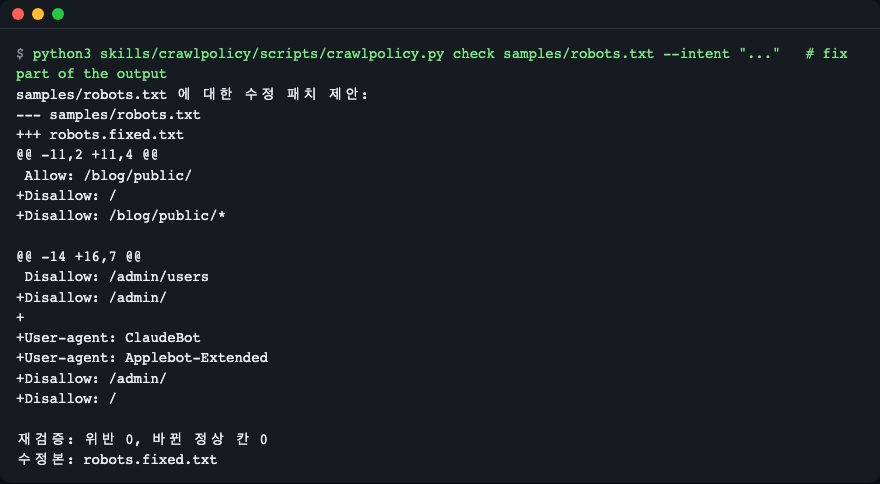
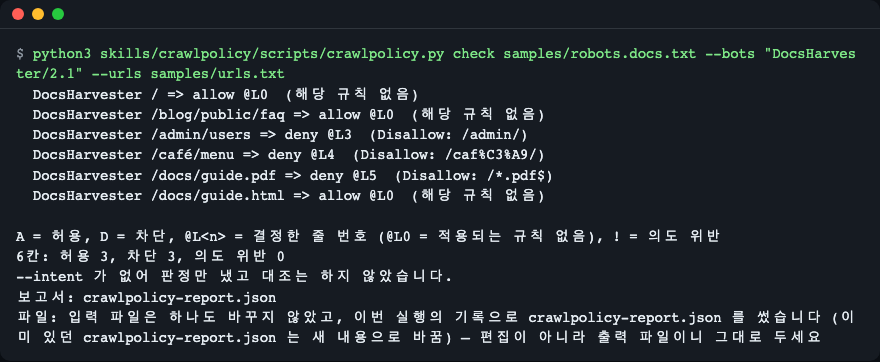
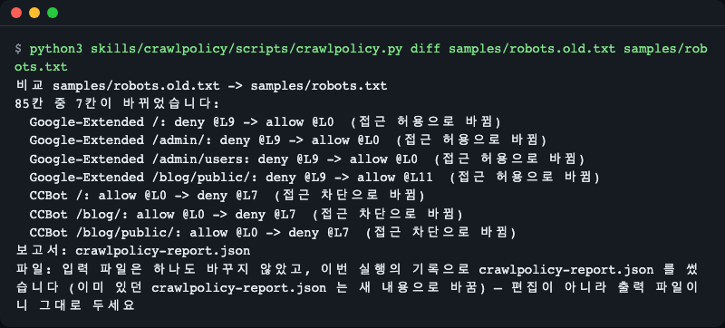
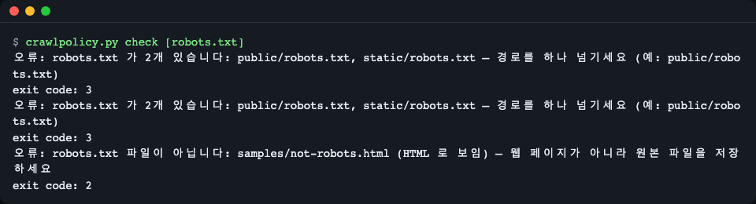
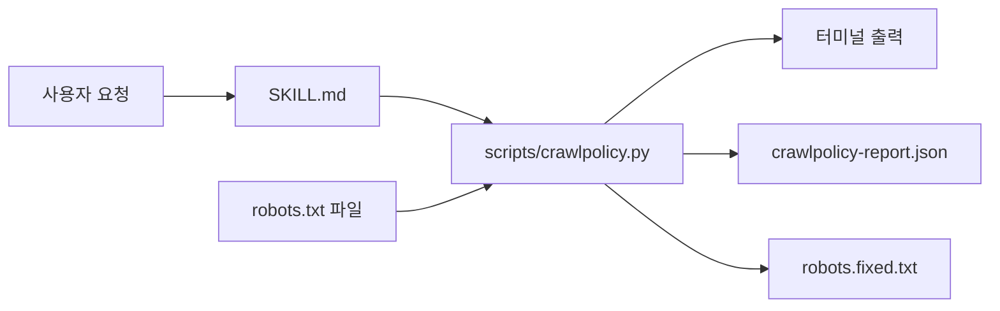

# crawlpolicy

[English](README.md) | **한국어**

저장해 둔 `robots.txt` 가 AI 크롤러와 URL 마다 실제로 무엇을 허용·차단하는지 알려 주는 에이전트 스킬입니다. 코딩 에이전트에게 "내 robots.txt 가 학습용 크롤러는 막고 검색 크롤러는 허용하나?" 하고 물으면, 번들 스크립트(파이썬 표준 라이브러리, 네트워크 없음)를 한 번 실행해 모든 봇·URL 을 RFC 9309 로 판정하고, 판정을 내린 규칙 줄을 보여 주고, 의도와 비교하고, 최소 수정안을 제안하고, 수정본을 다시 검증하고, 옛 파일과 새 파일을 비교합니다.


*`samples/robots.txt` 의 판정 표: `A@L3` 은 3번 줄이 허용, `D@L7` 은 7번 줄이 차단, `@L0` 은 적용되는 규칙 없음, `!` 는 의도 위반입니다.*

## 무엇을 하나

- **판정 표** — 모든 봇 x URL 칸을 `<bot> <url> => allow|deny @L<n>` 으로, 이긴 규칙 줄과 함께 보여 줍니다(가장 긴 일치 우선, 동점은 Allow, `*`·`$`, 퍼센트 인코딩, 같은 토큰의 여러 그룹 병합).
- **의도 비교** — `training=deny; search=allow; all:/admin/=deny` 같은 한 줄 의도와 비교해 어긴 절과 함께 위반을 나열합니다.
- **검증된 최소 수정** — 추가할 줄을 `robots.fixed.txt` 로 쓰고(원본은 고치지 않습니다) 수정본을 판정 표의 URL, 규칙 경로, 의도 경로와 각각의 하위 탐침 URL 로 다시 판정합니다: `re-verified: 0 violations, 0 changed cells`. 더 강한 확인은 `--urls` 로 실제 사이트 URL 을 넘기세요.
- **수집기 모드** — "내 RAG 수집기 `DocsHarvester/2.1` 이 이 URL 들을 가져가도 되나?" 를 `--bots`·`--urls` 로 확인합니다.
- **CI 용 비교** — `diff OLD NEW` 는 판정이 바뀐 칸만 보여 주고, 하나라도 바뀌면 종료 코드 1 입니다.
- **영어·한국어 출력** — `--lang en|ko`.

## 왜 스크립트인가

robots.txt 를 건물 출입 규칙표라고 생각해 보세요. 표를 눈으로 읽는 경비원은 몇 가지를 틀리고, 언어 모델도 마찬가지입니다.

1. **가장 긴 일치 규칙이 이깁니다.** 첫 번째 규칙이 아닙니다. 길이가 같으면 Allow 가 이깁니다.
2. **자기 그룹이 있는 봇은 `*` 그룹을 물려받지 않습니다.** `samples/robots.txt` 에서 `Google-Extended` 는 자기 그룹이 있어서, `*` 가 `/admin/` 을 막아도 이 봇에게는 `/admin/` 이 열려 있습니다.
3. 봇 이름은 **정확히** 같아야 합니다. `Applebot` 그룹은 `Applebot-Extended` 에 적용되지 않습니다.
4. 같은 봇의 여러 그룹은 하나로 합쳐지고, `*`·`$`·퍼센트 인코딩 경로(`%C3%A9` = `é`)에는 각자 규칙이 있습니다.

기존 파서들도 이 중 일부에서 서로 다르게 답합니다. 아래 표는 손으로 쓴 RFC 9309 사례 24개(2026-11-14 확인) 중 구현의 답이 RFC 와 다른 개수입니다.

| 구현 | 불일치 |
|---|---|
| 파이썬 `urllib.robotparser`, 3.12 이하 | 10 / 24 |
| 파이썬 `urllib.robotparser`, 3.13 이상 | 2 / 24 |
| protego 0.7.0 | 2 / 24 |
| robotspy 0.13.0 | 1 / 24 |
| google/robotstxt (`22b355f`) | 2 / 24 |
| crawlpolicy (이 스크립트) | 0 / 24 (`tests/test_rfc_cases.py`) |

출처: [RFC 9309](https://www.rfc-editor.org/rfc/rfc9309), [google/robotstxt](https://github.com/google/robotstxt), [protego](https://github.com/scrapy/protego), [robotspy](https://github.com/andreburgaud/robotspy).

## 설치

**Claude Code**

```
/plugin marketplace add LeeGyeongPil/crawlpolicy
/plugin install crawlpolicy@crawlpolicy-skill
```

**다른 에이전트(Agent Skills 표준)** — `skills/crawlpolicy` 를 에이전트의 스킬 폴더로 복사합니다. 플러그인 없이 Claude Code 를 쓰면 `.claude/skills/`, Codex CLI 는 `.agents/skills/`.

파이썬 3.10 이상(`python3 --version`)만 있으면 됩니다. 최소 리눅스 이미지에서는 `apt-get install -y python3`.

## 빠르게 시작하기 (에이전트 없이)

```bash
git clone https://github.com/LeeGyeongPil/crawlpolicy && cd crawlpolicy
python3 skills/crawlpolicy/scripts/crawlpolicy.py check samples/robots.txt \
  --intent "search=allow; user=allow; training=deny; control=deny; all:/admin/=deny"
```

판정 표는 위에 있습니다. 그 아래로 위반과 수정안이 나옵니다(위반이 있어서 종료 코드는 1 입니다). 아래는 영어 출력의 일부입니다.

```
Intent violations (11):
  ! OAI-SearchBot /admin/ => allow @L0  (wanted deny by 'all:/admin/=deny')
  ! ClaudeBot / => allow @L0  (wanted deny by 'training=deny')
  ...
  ! Google-Extended /admin/users => allow @L0  (wanted deny by 'all:/admin/=deny')
  ...
```


*제안된 패치와 `re-verified: 0 violations, 0 changed cells` 줄(한국어 출력은 `재검증: 위반 0, 바뀐 정상 칸 0`). 재검증은 모든 봇을 판정 표의 URL, 규칙·의도 경로, 각각의 하위 탐침 URL(예: `/blog/public/x`)로 판정합니다. 이 범위 밖 URL 은 보장하지 않으니 더 강한 확인은 `--urls` 로 실제 사이트 URL 을 넘기세요. 긴 패치는 40줄에서 잘리고 전체는 `robots.fixed.txt` 에 있습니다.*

`Google-Extended /admin/users` 가 열린 이유: 이 봇의 그룹에는 `/admin/` 규칙이 없고, 그룹은 `*` 를 물려받지 않습니다. `ClaudeBot` 은 그룹이 아예 없어서 `*` 로 떨어지는데, `*` 는 `/admin/` 만 막습니다.

## 사용법

에이전트에게 평소 말투로 요청하면 됩니다(스킬 이름을 말할 필요 없음).

- "I want AI training crawlers blocked but ChatGPT search and Perplexity still able to see my docs. Is my robots.txt doing that?" (학습용 AI 크롤러는 막고 ChatGPT 검색과 Perplexity 는 문서를 볼 수 있게 하고 싶은데, 내 robots.txt 가 그렇게 되어 있나?)
- "Our RAG ingester identifies as DocsHarvester/2.1. Which URLs in urls.txt are we allowed to fetch under the site's robots.txt (saved here)?" (우리 RAG 수집기는 DocsHarvester/2.1 로 접속한다. 저장해 둔 robots.txt 기준으로 urls.txt 의 어떤 URL 을 가져가도 되나?)
- "Python's robotparser says /shop/public/a.html is disallowed even though I have Allow: /shop/public. What does the spec actually say for this file?" (파이썬 robotparser 는 Allow: /shop/public 이 있는데도 차단이라고 한다. 표준은 이 파일에 대해 뭐라고 하나?)
- "robots.txt 에서 학습용 AI 크롤러만 막고 검색 크롤러는 허용되게 되어 있는지 확인해 줘."

수집기 예시(`samples/robots.docs.txt` 에는 퍼센트 인코딩 규칙과 `$` 규칙이 있습니다):

```bash
python3 skills/crawlpolicy/scripts/crawlpolicy.py check samples/robots.docs.txt --bots "DocsHarvester/2.1" --urls samples/urls.txt
```


*작은 실행은 URL 마다 이긴 규칙과 함께 한 줄씩 출력합니다. `DocsHarvester/2.1` 은 토큰 `DocsHarvester` 로 정규화되고, `/café/menu` 는 4번 줄의 규칙 `/caf%C3%A9/` 로 차단됩니다.*

파일 두 버전 비교(CI 에 유용: 종료 코드 1 이면 무언가 바뀐 것):

```bash
python3 skills/crawlpolicy/scripts/crawlpolicy.py diff samples/robots.old.txt samples/robots.txt
```


*75칸 중 7칸이 바뀌었습니다: `Google-Extended` 는 열렸고(`(접근 허용으로 바뀜)`) `CCBot` 은 막혔습니다(`(접근 차단으로 바뀜)`).*

## 의도 문법

`<who>[:<path>]=allow|deny`, 절은 `;` 로 잇습니다. 뒤의 절이 앞의 절을 덮어쓰고, 어떤 절도 다루지 않는 칸은 검사하지 않습니다.

| `<who>` | 뜻 |
|---|---|
| `training` | 학습 데이터를 모으는 크롤러(`GPTBot`, `ClaudeBot`, `CCBot`) |
| `search` | 검색 크롤러(`OAI-SearchBot`, `Claude-SearchBot`, `Googlebot`, `Applebot`, `PerplexityBot`) |
| `user` | 사용자 요청으로 가져오는 봇(`ChatGPT-User`, `Claude-User`, `Perplexity-User`) |
| `control` | 수집된 내용의 사용 방식만 정하는 제어 토큰(`Google-Extended`, `Applebot-Extended`) |
| `ai` | 표에 있는 모든 AI 봇 |
| `all` | 검사하는 모든 봇 |
| 토큰 | 봇 하나, 예: `GPTBot` |

`<path>` 는 robots 패턴(`/admin/`, `/*.pdf$`)이고 기본값은 `/` 입니다. 예: `ai=deny`, `training=deny; search=allow`, `all:/admin/=deny`, `GPTBot=deny; all:/blog/=allow`.

## 내장 크롤러 표

| 토큰 | 제공자 | 역할 | 출처 |
|---|---|---|---|
| GPTBot, OAI-SearchBot, ChatGPT-User, OAI-AdsBot | OpenAI | training, search, user, other | [bots](https://developers.openai.com/api/docs/bots) |
| ClaudeBot, Claude-SearchBot, Claude-User | Anthropic | training, search, user | [지원 문서](https://support.claude.com/en/articles/8896518-does-anthropic-crawl-data-from-the-web-and-how-can-) |
| Google-Extended, Google-CloudVertexBot, Googlebot | Google | control, other, search | [common crawlers](https://developers.google.com/crawling/docs/crawlers-fetchers/google-common-crawlers) |
| Applebot, Applebot-Extended | Apple | search, control | [Apple 지원](https://support.apple.com/en-us/119829) |
| PerplexityBot, Perplexity-User | Perplexity | search, user | [bots](https://docs.perplexity.ai/guides/bots) |
| CCBot | Common Crawl | training | [CCBot](https://commoncrawl.org/ccbot) |

2026-11-14 확인. Bingbot 은 해당 페이지를 확인하지 못해 표에서 뺐습니다. `--bots` 로 아무 토큰이나 넘기거나, `--bots-file FILE`(`{"token": ..., "role": ...}` 의 JSON 목록)로 표 전체를 바꿀 수 있습니다.

## 출력

- 터미널: 판정 표, 위반, 패치, `re-verified: ...`(한국어 출력은 `재검증: ...`), 제공자 메모. 작은 실행(봇 하나, 12칸 이하, 또는 `--url`/`--urls` 로 URL 을 준 60칸 이하)은 판정 표 대신 칸마다 이긴 규칙 문장 또는 `(해당 규칙 없음)` 이 붙은 `<bot> <url> => allow|deny @L<n>  (<rule>)` 한 줄을 냅니다. 75칸짜리 데모처럼 큰 실행은 표를 그대로 씁니다.
- 작업 폴더의 `crawlpolicy-report.json`: `source.sha256`, `verdict`·`rule_line` 이 있는 칸, 위반, `fix.verified`, `fix.violations_after`, `fix.regressions`. 키는 두 언어에서 같고, 실행할 때마다 덮어씁니다. 수정 안 한 `robots.fixed.txt` 에 `check`·`diff` 를 다시 돌리면 원래 report 는 그대로 두고 결과를 안내 문구와 함께 `crawlpolicy-report.fixed.json` 에 씁니다. fix 실행이 이미 재검증 결과를 출력하므로 이 두 번째 실행은 필요 없습니다.
- `--out /dev/null`: 보고서를 남기지 않습니다. 판정과 패치는 그대로 출력하고 `files:` 줄이 보고서를 남기지 않았다고 알립니다. 작업 폴더에 쓸 수 없으면(읽기 전용·권한 없음) 아무것도 쓰지 않고 모든 판정·패치·`re-verified:` 줄을 출력하며 stderr 에 경고 한 줄을 냅니다. 종료 코드는 판정을 따릅니다. 직접 준 `--out` 에 쓸 수 없으면 입력 오류(종료 2)입니다.
- 모든 실행은 `files:` 줄(한국어 출력은 `파일:`)로 끝납니다. 입력 파일은 하나도 바꾸지 않았고 이번에 쓴 출력 파일(보고서, 수정안이 있으면 `robots.fixed.txt` 도)이 적힙니다. 앞선 실행이 남긴 보고서나 `robots.fixed.txt` 를 바꿨다면 그 사실도 밝힙니다(`... already existed and was replaced`). 편집이 아니라 출력이니 그대로 두세요. `--out`·`--fixed-out` 이 입력 파일(robots.txt, `--urls`, `--bots-file`)이나 서로를 가리키면 옵션 이름을 적어 거부합니다(종료 2). 예: `error: --fixed-out urls.txt would overwrite the --urls file — choose another path`(한국어 출력은 `오류: ...`). 직접 준 `--out` 은 crawlpolicy 보고서가 아닌 기존 파일을 바꾸지 않습니다. 직접 고른 `--fixed-out` 경로에 파일이 이미 있으면 교체하고 `files:` 줄이 알려 줍니다. 잘못된 URL 은 한 줄 오류와 종료 2 입니다.
- 종료 코드: `0` 의도 충족 또는 바뀐 것 없음, `1` 위반 발견 또는 판정 변경, `2` 입력 문제(파일 없음·HTML 페이지·바이너리·잘못된 `--intent`), `3` robots.txt 를 하나로 정하지 못함(자동 탐지는 `./`, `public/`, `static/`, `app/` 를 봅니다). 맨 이름 `robots.txt` 인자도 `public/`·`static/`·`app/` 에 다른 후보가 있으면 생략한 것으로 보고 종료 3 과 `error: found 2 robots.txt files: ... — pass one path, e.g. ./robots.txt`(한국어 출력: `오류: robots.txt 가 2개 있습니다: ... — 경로를 하나 넘기세요 (예: ./robots.txt)`)를 냅니다. `./robots.txt` 나 다른 경로는 그대로 씁니다.


*오류는 입력을 고치는 방법을 알려 주는 한 줄이며 트레이스백이 없습니다.*

CI 예시: `python3 skills/crawlpolicy/scripts/crawlpolicy.py diff robots.old.txt robots.txt` 는 변경이 크롤러를 열거나 닫으면 작업을 실패시킵니다.

## 언어

`--lang en|ko` 가 환경변수 `CRAWLPOLICY_LANG` 보다, 그것이 `LC_ALL` / `LC_MESSAGES` / `LANG` 보다 우선합니다(`ko` 로 시작하면 한국어, 그 밖은 영어). `--help` 도 번역됩니다.

```bash
CRAWLPOLICY_LANG=ko python3 skills/crawlpolicy/scripts/crawlpolicy.py diff samples/robots.old.txt samples/robots.txt
```

## 검증된 동작

<!-- skill-eval:start -->
| 확인 | 결과 |
|---|---|
| 필요할 때 불림 | 11/12 |
| 필요 없을 때 안 불림 | 11/11 |
| 스킬로 푼 작업 | 7/7 |
| 스킬 없이 푼 작업(기준선) | 0/7 |
| 평균 점수 차이(Δ) | +0.58 |
| 가짜 스크립트를 잡아낸 비율 | 7/7 |
| Codex CLI | 작업 7/7 통과 · 확인됨 |

Claude Code 2.1.322 · sonnet · 케이스마다 3회 · 2026-11-15 측정 · codex-cli 0.154.0
<!-- skill-eval:end -->

## 동작 원리



에이전트가 `SKILL.md` 를 읽고 스크립트를 한 번 실행해 그 출력으로 답합니다. 스크립트는 가리킨 robots.txt 파일(또는 `./`, `public/`, `static/`, `app/` 에서 찾은 것)만 읽고, 작업 폴더에 보고서와 수정본을 쓰며, 네트워크를 쓰지 않고 그 밖의 권한도 필요 없습니다.

## 하지 않는 것

- 아무것도 내려받지 않습니다. 사이트의 robots.txt 를 먼저 저장해 두세요.
- HTTP 상태 규칙(4xx 는 모두 허용, 5xx 는 모두 차단)과 Apple 의 `Applebot` → `Googlebot` 규칙 대체는 적용하지 않습니다(메모만 출력).
- `ChatGPT-User` 같은 사용자 요청 봇은 robots.txt 를 따르지 않을 수 있고, `Google-Extended` 같은 제어 토큰은 직접 크롤링하지 않습니다. robots.txt 는 강제가 아니라 요청이므로, 차단하려면 서버 규칙을 쓰세요.
- `llms.txt`, meta robots 태그, `X-Robots-Tag` 헤더, 사이트맵은 다루지 않습니다.

## 언제 쓰나

잘 맞는 상황: 배포 전에 AI 학습 크롤러는 막고 검색 크롤러는 허용하는 robots.txt 인지 확인할 때, 내 수집기가 URL 목록을 가져가도 되는지 확인할 때. 운영 중인 사이트의 크롤러 접근을 확인하거나 크롤러를 만드는 일에는 다른 도구를 보세요. 이 스킬은 저장한 파일만 다룹니다.

## 개발

```
uv sync && uv run pytest -q
```

테스트 240개가 통과합니다(`uv run pytest -q`, 파이썬 3.10·3.12·3.14 CI 매트릭스). `evals/` 폴더에는 발동 케이스 12개(한국어 3개), 비발동 케이스 11개, 픽스처가 있는 작업 케이스 7개가 있고 `claude plugin eval` 이 사용합니다.

## 라이선스

MIT
