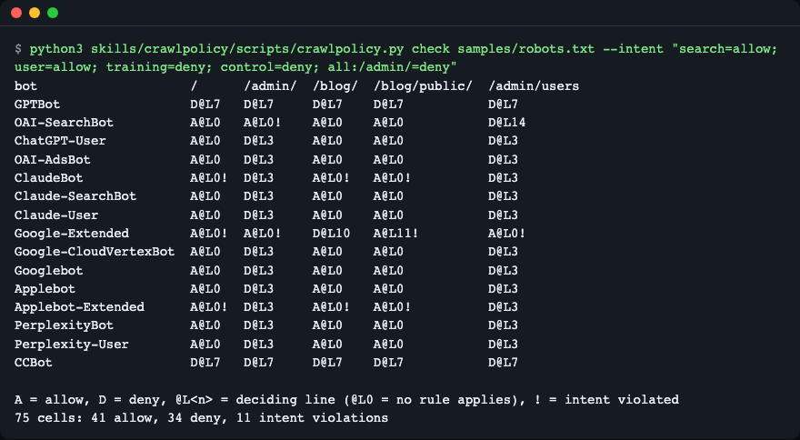
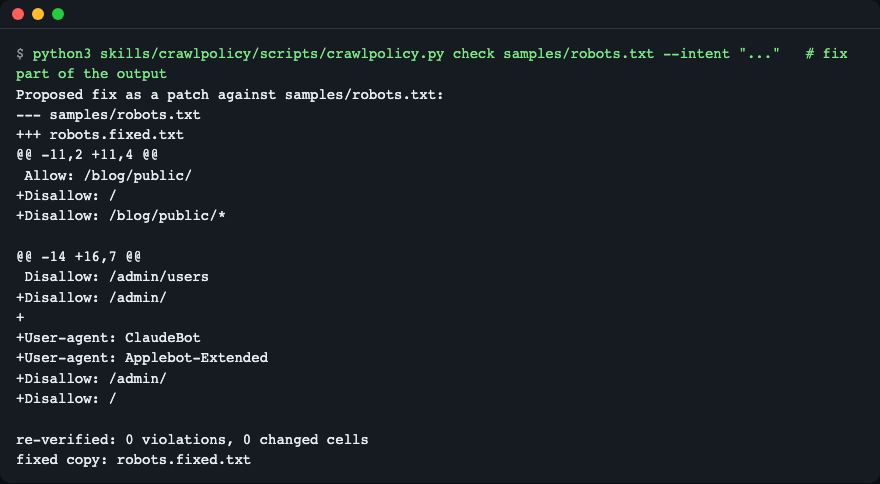
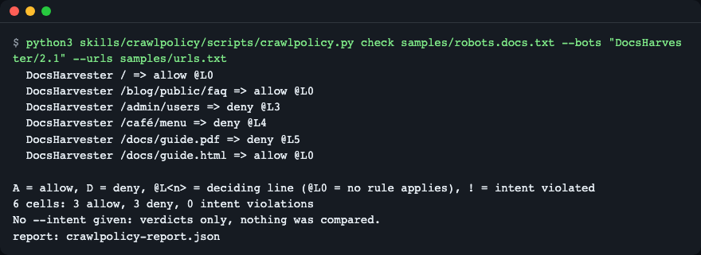
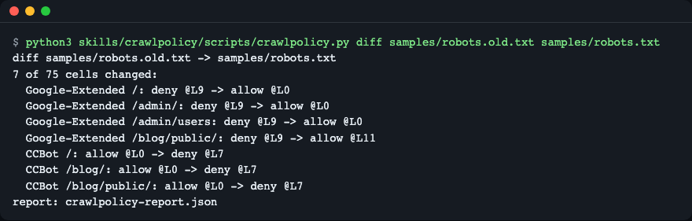
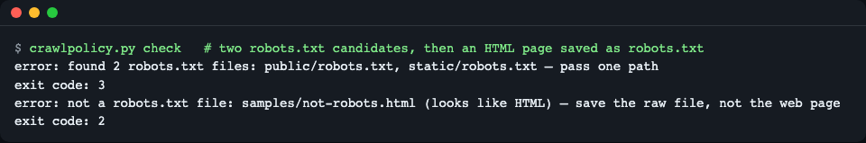
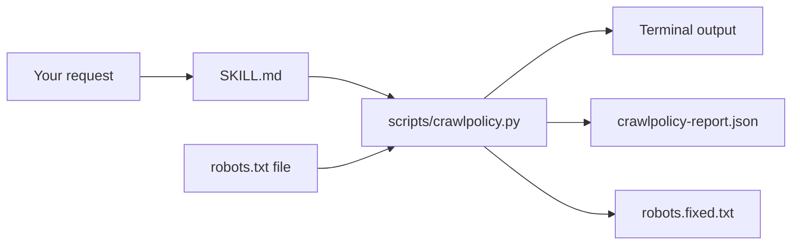

# crawlpolicy

**English** | [한국어](README.ko.md)

An agent skill that tells you what a saved `robots.txt` really allows for each AI crawler and URL. Ask your coding agent "does my robots.txt keep training crawlers out but search crawlers in?" and one bundled script run (Python standard library, no network) judges every bot and URL by RFC 9309, shows the rule line that decided each answer, compares the result with your intent, proposes a minimal fix, re-verifies the fixed copy and diffs old and new files.


*The verdict matrix for `samples/robots.txt`: `A@L3` means allow decided by line 3, `D@L7` deny by line 7, `@L0` no rule applies, `!` the intent is violated.*

## What it does

- **Verdict matrix** — every bot x URL cell as `<bot> <url> => allow|deny @L<n>`, with the winning rule line (longest match wins, Allow wins ties, `*` and `$`, percent-encoding, groups with the same token merged).
- **Intent check** — one line such as `training=deny; search=allow; all:/admin/=deny`; violations are listed with the clause they break.
- **Verified minimal fix** — added lines are written to `robots.fixed.txt` (your file is never edited) and the fixed copy is judged again against the matrix URLs, the rule paths, the intent paths and a child probe under each of them: `re-verified: 0 violations, 0 changed cells`. For a stronger check pass real site URLs with `--urls`.
- **Collector mode** — "may my RAG ingester `DocsHarvester/2.1` fetch these URLs?" with `--bots` and `--urls`.
- **Diff for CI** — `diff OLD NEW` lists only the cells whose verdict changed; exit code 1 when any did.
- **English and Korean output** — `--lang en|ko`.

## Why a script

Think of robots.txt as a building's access-rule sheet. A guard who reads it by hand gets some rules wrong, and so do language models:

1. The **longest matching rule wins**, not the first one; on a tie, Allow wins.
2. A bot that has **its own group does not inherit the `*` group**. In `samples/robots.txt`, `Google-Extended` has its own group, so `/admin/` is open for it although `*` blocks `/admin/`.
3. The bot name must match **exactly**: a group for `Applebot` does not apply to `Applebot-Extended`.
4. Several groups for the same bot merge into one; `*`, `$` and percent-encoded paths (`%C3%A9` = `é`) have their own rules.

Existing parsers disagree on some of these. The table is the number of cases (of 24 hand-written RFC 9309 cases, checked 2026-11-14) where an implementation's answer differs from the RFC's:

| Implementation | Mismatches |
|---|---|
| Python `urllib.robotparser`, 3.12 and older | 10 / 24 |
| Python `urllib.robotparser`, 3.13+ | 2 / 24 |
| protego 0.7.0 | 2 / 24 |
| robotspy 0.13.0 | 1 / 24 |
| google/robotstxt (`22b355f`) | 2 / 24 |
| crawlpolicy (this script) | 0 / 24 (`tests/test_rfc_cases.py`) |

Sources: [RFC 9309](https://www.rfc-editor.org/rfc/rfc9309), [google/robotstxt](https://github.com/google/robotstxt), [protego](https://github.com/scrapy/protego), [robotspy](https://github.com/andreburgaud/robotspy).

## Install

**Claude Code**

```
/plugin marketplace add LeeGyeongPil/crawlpolicy
/plugin install crawlpolicy@crawlpolicy-skill
```

**Other agents (Agent Skills standard)** — copy `skills/crawlpolicy` into the agent's skills folder, for Claude Code without the plugin: `.claude/skills/`.

Needs Python 3.10+ (`python3 --version`); nothing else. On a minimal Linux image: `apt-get install -y python3`.

## Quick start (no agent needed)

```bash
git clone https://github.com/LeeGyeongPil/crawlpolicy && cd crawlpolicy
python3 skills/crawlpolicy/scripts/crawlpolicy.py check samples/robots.txt \
  --intent "search=allow; user=allow; training=deny; control=deny; all:/admin/=deny"
```

The matrix is shown above. Below it come the violations and the fix (the command exits with code 1 because violations were found):

```
Intent violations (11):
  ! OAI-SearchBot /admin/ => allow @L0  (wanted deny by 'all:/admin/=deny')
  ! ClaudeBot / => allow @L0  (wanted deny by 'training=deny')
  ...
  ! Google-Extended /admin/users => allow @L0  (wanted deny by 'all:/admin/=deny')
  ...
```


*The proposed patch and the line `re-verified: 0 violations, 0 changed cells`. Re-verification judges every bot on the matrix URLs, the rule and intent paths and a child probe under each (for example `/blog/public/x`); it does not cover URLs outside that set, so pass real site URLs with `--urls` for a stronger check. Long patches are cut to 40 lines; the full copy is in `robots.fixed.txt`.*

Why `Google-Extended /admin/users` is open: its group has no `/admin/` rule and groups do not inherit `*`. `ClaudeBot` has no group at all, so it falls back to `*`, which blocks only `/admin/`.

## Use it

Ask your agent in plain words (no skill name needed):

- "I want AI training crawlers blocked but ChatGPT search and Perplexity still able to see my docs. Is my robots.txt doing that?"
- "Our RAG ingester identifies as DocsHarvester/2.1. Which URLs in urls.txt are we allowed to fetch under the site's robots.txt (saved here)?"
- "Python's robotparser says /shop/public/a.html is disallowed even though I have Allow: /shop/public. What does the spec actually say for this file?"
- "robots.txt 에서 학습용 AI 크롤러만 막고 검색 크롤러는 허용되게 되어 있는지 확인해 줘."

Collector example (`samples/robots.docs.txt` has a percent-encoded rule and a `$` rule):

```bash
python3 skills/crawlpolicy/scripts/crawlpolicy.py check samples/robots.docs.txt --bots "DocsHarvester/2.1" --urls samples/urls.txt
```


*`DocsHarvester/2.1` is normalized to the token `DocsHarvester`; `/café/menu` is denied by the rule `%C3%A9` on line 4.*

Compare two versions of the file (useful in CI: exit code 1 means something changed):

```bash
python3 skills/crawlpolicy/scripts/crawlpolicy.py diff samples/robots.old.txt samples/robots.txt
```


*7 of 75 cells changed: `Google-Extended` opened up, `CCBot` got blocked.*

## Intent syntax

`<who>[:<path>]=allow|deny`, clauses joined by `;`. A later clause overrides an earlier one; cells no clause covers are not checked.

| `<who>` | Meaning |
|---|---|
| `training` | crawlers that collect training data (`GPTBot`, `ClaudeBot`, `CCBot`) |
| `search` | search crawlers (`OAI-SearchBot`, `Claude-SearchBot`, `Googlebot`, `Applebot`, `PerplexityBot`) |
| `user` | fetches made for a user request (`ChatGPT-User`, `Claude-User`, `Perplexity-User`) |
| `control` | control tokens that only say how crawled content may be used (`Google-Extended`, `Applebot-Extended`) |
| `ai` | all AI bots in the table |
| `all` | every bot checked |
| a token | one bot, for example `GPTBot` |

`<path>` is a robots pattern (`/admin/`, `/*.pdf$`), default `/`. Examples: `ai=deny`, `training=deny; search=allow`, `all:/admin/=deny`, `GPTBot=deny; all:/blog/=allow`.

## Built-in crawler table

| Token | Provider | Role | Source |
|---|---|---|---|
| GPTBot, OAI-SearchBot, ChatGPT-User, OAI-AdsBot | OpenAI | training, search, user, other | [bots](https://developers.openai.com/api/docs/bots) |
| ClaudeBot, Claude-SearchBot, Claude-User | Anthropic | training, search, user | [support article](https://support.claude.com/en/articles/8896518-does-anthropic-crawl-data-from-the-web-and-how-can-) |
| Google-Extended, Google-CloudVertexBot, Googlebot | Google | control, other, search | [common crawlers](https://developers.google.com/crawling/docs/crawlers-fetchers/google-common-crawlers) |
| Applebot, Applebot-Extended | Apple | search, control | [Apple support](https://support.apple.com/en-us/119829) |
| PerplexityBot, Perplexity-User | Perplexity | search, user | [bots](https://docs.perplexity.ai/guides/bots) |
| CCBot | Common Crawl | training | [CCBot](https://commoncrawl.org/ccbot) |

Checked 2026-11-14. Bingbot is not in the table because its page could not be verified; pass any token with `--bots`, or replace the whole table with `--bots-file FILE` (a JSON list of `{"token": ..., "role": ...}`).

## Output

- Terminal: the matrix, violations, patch, `re-verified: ...`, provider notes. A single bot prints one `<bot> <url> => allow|deny @L<n>` line per URL.
- `crawlpolicy-report.json` in the working folder: `source.sha256`, cells with `verdict` and `rule_line`, violations, `fix.verified`, `fix.violations_after`, `fix.regressions`. Keys are the same in both languages. Each run overwrites the file.
- `robots.fixed.txt`: the fixed copy.
- Exit codes: `0` intent holds or nothing changed; `1` violations found or verdicts changed; `2` input problem (missing file, HTML page, binary file, bad `--intent`); `3` no single robots.txt found (auto-detect looks in `./`, `public/`, `static/`, `app/`).


*Errors are one line that says how to fix the input, no traceback.*

CI example: `python3 skills/crawlpolicy/scripts/crawlpolicy.py diff robots.old.txt robots.txt` fails the job when a change opens or closes a crawler.

## Language

`--lang en|ko` beats the `CRAWLPOLICY_LANG` environment variable, which beats `LC_ALL` / `LC_MESSAGES` / `LANG` (starting with `ko` means Korean, anything else English). `--help` is translated too.

```bash
CRAWLPOLICY_LANG=ko python3 skills/crawlpolicy/scripts/crawlpolicy.py diff samples/robots.old.txt samples/robots.txt
```

## Verified behavior

<!-- skill-eval:start -->
| Check | Result |
|---|---|
| Triggers when it should | 11/12 |
| Stays quiet when it should not | 11/11 |
| Tasks solved with the skill | 7/7 |
| Tasks solved without it (baseline) | 0/7 |
| Mean score gain (Δ) | +0.50 |
| Tasks that catch a broken script | 7/7 |
| Codex CLI | not verified |

Measured 2026-11-14 with Claude Code 2.1.322 · sonnet · 3 runs per case · codex-cli 0.154.0
<!-- skill-eval:end -->

## How it works



The agent reads `SKILL.md`, runs the script once and answers from its output. The script reads only the robots.txt file(s) you point at (or find in `./`, `public/`, `static/`, `app/`), writes the report and the fixed copy in the working folder, uses no network and needs no permissions beyond that.

## What it does not do

- It does not fetch anything: save the site's robots.txt first.
- It does not apply HTTP status rules (4xx means allow all, 5xx means deny all) and does not apply Apple's fallback from `Applebot` to `Googlebot` rules (it prints a note).
- User-request bots such as `ChatGPT-User` may not follow robots.txt, and control tokens such as `Google-Extended` do not crawl by themselves. robots.txt is a request, not enforcement; use server rules to block.
- Not for `llms.txt`, meta robots tags, `X-Robots-Tag` headers or sitemaps.

## When to use it

Good fits: checking a robots.txt before deploy when you want AI training crawlers out and search crawlers in; checking whether your own collector may fetch a list of URLs. For checking a live site's crawler access or writing a crawler, look at other tools; this one works on a saved file only.

## Development

```
uv sync && uv run pytest -q
```

109 tests pass (`uv run pytest -q`, Python 3.10, 3.12 and 3.14 in the CI matrix). The `evals/` folder holds 12 trigger cases (3 in Korean), 11 no-trigger cases and 7 task cases with fixtures, used by `claude plugin eval`.

## License

MIT
